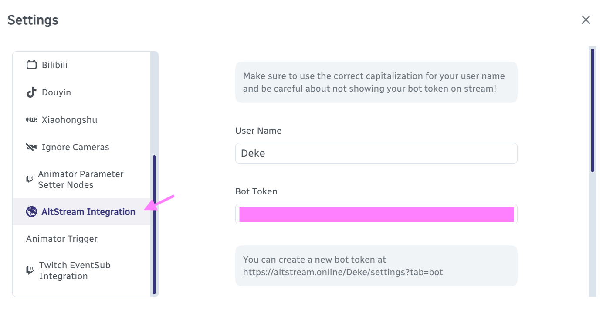
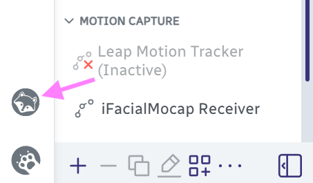

# Warudo_AltStream
*A Warudo plugin to allow for interaction with the [AltStream](https://altstream.online) streaming service!*

*~by **DEKE*** [[Bluesky](https://bsky.app/profile/deke.studio) | [AltStream](https://altstream.online/deke)]

### Download & Installation

---
You can grab the latest version of the Plugin from the release page.

To install the plugin, put the downloaded `.warudo` file into your `steamapps/common/Warudo/Warudo_Data/StreamingAssets/Plugins` folder.

*You can also navigate to the Warudo folder by right-clicking Warudo in Steam and selecting `Manage->Browse Local Files`.*

### Setup & Usage

---
After you copied the plugin to Warudo's plugin folder, you'll be able to set it up in your `Settings` menu.

1. Make sure to enter your user name into the `User Name` field. 

    ❗**Important**: Right now, correct capitalization is important for the AltStream API to send the necessary responses. If you're having trouble connecting, that's one of the first things you should check.

2. Afterwards, you can either copy/paste the link from the text box below or click `Create Bot Token` to navigate to your AltStream dashboard to create a new Bot Token.
   
    Make sure to save your token in a safe location and **definitely** make sure to never show your token to anyone else. Then copy the token into the `Bot Token` field.

3. Click `Connect To Altstream` to connect to the AltStream service. It might take a few seconds until the connection has been established. While it's connecting, you can close the settings menu. 
    
    You'll see if the plugin has successfully connected to the AltStream API when the AltStream icon pops up in your left toolbar!

### Building

---
To build the plugin yourself, make sure you have a Warudo SDK project setup. You can find more information in the [Warudo Documentation](https://docs.warudo.app/docs/tutorials/getting-started).

❗*Make sure you're using at least **version 0.14.4** of the SDK!*

Create a new mod inside your Warudo mod project in Unity and either pull this repository into the plugin folder, or copy/paste it from a custom download location. Then just build it like normal using Warudo's mod manager.

### Contributing

---
Pull requests and issues are open, but, at least at this point in time, only improvements/fixes to existing features will be merged.

This plugin is also meant as a bit of a web(-ish) dev learning experience for me, since I've become quite rusty. So, for now, I'd like to implement new features myself. But you're of course free to open any issues on feature requests and such!

### No AI

---
AI agents, workflows and code created by generative AI tools are strictly forbidden. Any PRs that contain LLM-generated code will not be merged and the user will be blacklisted from opening new PRs/Issues. 

Any PRs are required to be written by humans. If I become suspicious of a piece of submitted code, I will ask the respective contributor to explain their PR in detail.

Using this code for the purpose of training ML models is also strictly forbidden. See [**LICENSE.md**](LICENSE.md) for more information.

As such, this repository contains an [**AGENTS.md**](AGENTS.md) that explicitly forbids agents to interact with this codebase in any way. 